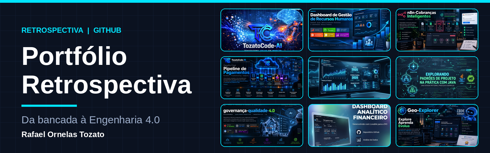

  
  
    

  <h1>🚀 Rafael Tozato | Portfólio Profissional</h1>
  
<b>Engenheiro de Software & Especialista em Engenharia 4.0, Automação, BI e IA</b>

  
Hub central e ecossistema de aplicações focados em transformar código e inteligência em soluções de alto impacto.

 

<!-- CATEGORIA 1: STATUS, QUALIDADE & GOVERNANÇA -->

  
  
  
  

<!-- CATEGORIA 2: STACK TÉCNICA & DESENVOLVIMENTO -->

  
  
  
  
  
  

<!-- CATEGORIA 3: DEVSECOPS, CI/CD & CLOUD -->

  
  
  
  

 

## 📄 Retrospectiva Profissional & Trajetória

  <h3>"Da Bancada à Engenharia 4.0"</h3>
  
Confira o material em PDF com a trajetória completa, marcos de carreira, governança e ecossistema técnico.

  

 

## 🛠️ Stack Tecnológica & Ecossistema

  
Ecossistema integrado voltado para alta performance, governança e inteligência artificial aplicada.

## 📌 Sobre o Projeto
Este repositório (`h-folio`) contém a aplicação principal e o portfólio web profissional, projetados com design moderno, navegação fluida, métricas, projetos em destaque, certificações e curadoria de conteúdos técnicos.

## 🚀 Projetos e Portfólios em Foco

* **01. tozato-ai-core:** Núcleo do ecossistema de aplicações e soluções inteligentes Tozato AI. [Ver Código no GitHub](https://github.com/Rafael-TOZATO/tozato-ai-core)
* **02. pipeline-pagamentos:** Pipeline de pagamentos em tempo real com CDC, Kafka, Flink SQL e detecção de fraude. [Ver Código no GitHub](https://github.com/Rafael-TOZATO/pipeline-pagamentos)
* **03. ats-resume-generator-dio:** Aplicação web para análise inteligente de currículos e otimização para sistemas ATS. [Ver Código no GitHub](https://github.com/Rafael-TOZATO/ats-resume-generator-dio)
* **04. n8n-cobrancas-inteligentes:** Automação financeira com n8n, Google Sheets e Gmail. [Ver Código no GitHub](https://github.com/Rafael-TOZATO/n8n-cobrancas-inteligentes)
* **05. dashboard-analitico-financeiro-dio:** Painel executivo interativo para acompanhamento de indicadores financeiros. [Ver Código no GitHub](https://github.com/Rafael-TOZATO/dashboard-analitico-financeiro-dio)
* **06. bootcamp-ibm-bob-ia-empresarial:** Trilha de capacitação e projetos em IA empresarial, dados e cloud IBM. [Ver Código no GitHub](https://github.com/Rafael-TOZATO/bootcamp-ibm-bob-ia-empresarial)
* **07. recomendacao-musicas-neo4j:** Sistema de recomendação musical com modelagem de relações em grafos Neo4j. [Ver Código no GitHub](https://github.com/Rafael-TOZATO/recomendacao-musicas-neo4j)
* **08. power_bi_analyst:** Projetos práticos de transformação, modelagem de dados e relatórios analíticos. [Ver Código no GitHub](https://github.com/Rafael-TOZATO/power_bi_analyst)
* **09. governanca-qualidade-4.0:** Materiais técnicos sobre qualidade preditiva, governança e automação industrial. [Ver Código no GitHub](https://github.com/Rafael-TOZATO/governanca-qualidade-4.0)
* **10. analise-de-vendas-financials-power-bi:** Relatório gerencial de vendas com navegação interativa e indicadores financeiros. [Ver Código no GitHub](https://github.com/Rafael-TOZATO/analise-de-vendas-financials-power-bi)
* **11. projeto-financial-sample-powerbi:** Modelagem Star Schema, transformação com Power Query e calendário DAX. [Ver Código no GitHub](https://github.com/Rafael-TOZATO/projeto-financial-sample-powerbi)
* **12. neo4j-certified-professional:** Estudo de bancos de grafos, consultas Cypher e documentação de certificação. [Ver Código no GitHub](https://github.com/Rafael-TOZATO/neo4j-certified-professional)

**Rafael Ornelas Tozato**

Engenharia Química | Garantia da Qualidade | Governança 4.0

## 📬 CONTATOS E PERFIS

💻 **PROJETOS E PORTFÓLIOS**
* Ecossistema de Aplicativo: [tozato-ai-core.vercel.app](https://tozato-ai-core.vercel.app)
* H-Folio Professional: [h-folio-I0.vercel.app](https://h-folio-I0.vercel.app)

🐙 **CÓDIGOS E REPOSITÓRIOS**
* GitHub: [github.com/Rafael-TOZATO](https://github.com/Rafael-TOZATO)

✍️ **ARTIGOS E PUBLICAÇÕES**
* Medium: [medium.com/@ornelas.tozato](https://medium.com/@ornelas.tozato)
* Comunidade DEV: [dev.to/rafaeltozato](https://dev.to/rafaeltozato)

💼 **CONTATO**
* LinkedIn: [linkedin.com/in/rafaeltozato81](https://www.linkedin.com/in/rafaeltozato81)
* E-mail: ornelas.tozato@gmail.com
