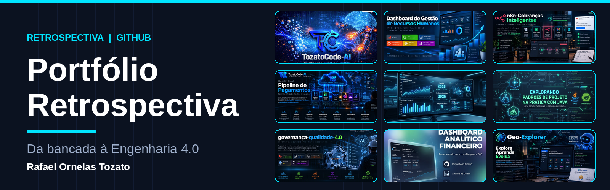

# 🚀 Rafael Ornelas Tozato — H-Folio & Ecossistema de Projetos

---

## 📌 Sobre o Aplicativo
O **H-Folio** é o ecossistema central de aplicações web e portfólio profissional de Rafael Ornelas Tozato, unindo engenharia de software, automações inteligentes, governança industrial e inteligência artificial.

---

## 💼 Perfil Profissional & Documentos
* **Currículo & Governança:** Trajetória sólida em Engenharia de Software, Qualidade e Governança Industrial (ISO 9001 e Lean Six Sigma).
* 📄 **Download do Documento / Carrossel (PDF):** [Visualizar Carrossel de Retrospectiva (PDF)](./Carrossel_Retrospectiva_GitHub_Rafael_Tozato.pdf)

---

## 🚀 Projetos, Portfólios & Apps em Foco

### 01. H-Folio (Este Aplicativo Principal)
* **Descrição:** Hub central e ecossistema de soluções web.
* **Link:** [h-folio-psi.vercel.app](https://h-folio-psi.vercel.app)

### 02. Hub de Projetos (Dev Hub / TozatoCode-AI)
* **Descrição:** Central de aplicações e ferramentas interativas.
* **Link:** [tozato-dev-hub.vercel.app](https://tozato-dev-hub.vercel.app)

### 03. Portfólio Retrospectiva *(Integrado)*
* **Descrição:** Consolidado da Retrospectiva Técnica e Profissional, unindo mais de 35 repositórios em Governança 4.0, Automação, BI e IA.
* **Repositório:** [portfolio-retrospectiva](https://github.com/Rafael-TOZATO/portfolio-retrospectiva)

### 04. Aurora BI DIO
* **Descrição:** Projeto de análise e visualização de dados orientado a decisões estratégicas.
* **Link:** [aurora-bi-dio.lovable.app](https://aurora-bi-dio.lovable.app)

### 05. Análise de Vendas Financials
* **Descrição:** Dashboard financeiro para explorar indicadores de vendas, desempenho e oportunidades de negócio.

### 06. ATS Resume Generator
* **Descrição:** Gerador inteligente de currículos otimizado para sistemas ATS, combinando produto, web e inteligência artificial.

### 07. n8n — Cobranças Inteligentes
* **Descrição:** Automação financeira integrada com n8n, Google Sheets e Gmail para organizar cobranças e reduzir tarefas operacionais.

### 08. Pipeline de Pagamentos
* **Descrição:** Pipeline em tempo real com Postgres, CDC, eventos Avro e Flink SQL para enriquecimento e detecção de fraudes.

### 09. Assistente de Investimentos
* **Descrição:** Ferramenta automatizada com Python, BeautifulSoup e n8n para transformar dados em insights acionáveis.

### 10. Dashboard de Gestão de RH
* **Descrição:** Dashboard corporativo em Power BI para análise de métricas de recursos humanos e tomada de decisão.

### 11. Dossiê Técnico Executivo & Governança
* **Descrição:** Dashboard analítico corporativo e interativo para rastreabilidade de credenciais e matriz tecnológica.

### 12. Projeto Final Design Patterns
* **Descrição:** Aplicação de padrões de projeto (Singleton, Strategy, Facade) para estruturar soluções escaláveis em Java/Spring.

---

## 🛠️ Tecnologias e Arquitetura
- **Frontend & Interfaces:** React, TypeScript, Tailwind CSS, Next.js
- **Infraestrutura & Deploy:** Vercel, Git / GitHub Actions
- **Automação & Processos:** n8n, Python, Power BI, Governança 4.0

---

## 📬 Contatos e Conexões

* 💼 **LinkedIn:** [rafaeltozato81](https://www.linkedin.com/in/rafaeltozato81)
* 🐙 **GitHub:** [Rafael-TOZATO](https://github.com/Rafael-TOZATO)
* ✍️ **Medium:** [@ornelas.tozato](https://medium.com/@ornelas.tozato)
* 🌐 **Dev Hub:** [tozato-dev-hub.vercel.app](https://tozato-dev-hub.vercel.app)
* 🌐 **H-Folio:** [h-folio-psi.vercel.app](https://h-folio-psi.vercel.app)
* 🚀 **Aurora BI:** [aurora-bi-dio.lovable.app](https://aurora-bi-dio.lovable.app)
* 📜 **Microsoft Learn:** [Transcrito Oficial](https://learn.microsoft.com/pt-br/users/rafaelornelastozato-2209/transcript/dzo2wizrkx2853)
