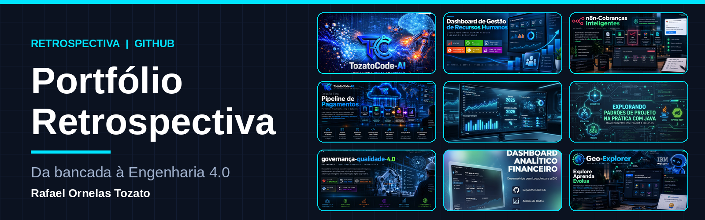

# 🚀 Rafael Ornelas Tozato — H-Folio & Ecossistema de Projetos

---

---

---

## 📌 Sobre o Aplicativo
O **H-Folio** é o ecossistema central de aplicações web e portfólio profissional de Rafael Ornelas Tozato, unindo engenharia de software, automações inteligentes, governança industrial e inteligência artificial.

---

---

---

## 🚀 Projetos, Portfólios & Apps em Foco

### 01. H-Folio (Este Aplicativo Principal)
* **Descrição:** Hub central e ecossistema de soluções web.
* **Link:** [h-folio-psi.vercel.app](https://h-folio-psi.vercel.app)

### 02. Hub de Projetos (Dev Hub / TozatoCode-AI)
* **Descrição:** Central de aplicações e ferramentas interativas.
* **Link:** [tozato-dev-hub.vercel.app](https://tozato-dev-hub.vercel.app)

### 03. Portfólio Retrospectiva *(Integrado)*
* **Descrição:** Consolidado da Retrospectiva Técnica e Profissional, reunindo projetos em Governança 4.0, Automação, BI e IA. O perfil GitHub exibia 41 repositórios na captura de 11/11/2026.
* **Repositório:** [portfolio-retrospectiva](https://github.com/Rafael-TOZATO/portfolio-retrospectiva)

### 04. Aurora BI DIO
* **Descrição:** Projeto de análise e visualização de dados orientado a decisões estratégicas.
* **Link:** [aurora-bi-dio.lovable.app](https://aurora-bi-dio.lovable.app)

### 05. Análise de Vendas Financials
* **Descrição:** Dashboard financeiro para explorar indicadores de vendas, desempenho e oportunidades de negócio.

### 06. ATS Resume Generator
* **Descrição:** Gerador inteligente de currículos otimizado para sistemas ATS, combinando produto, web e inteligência artificial.

### 07. n8n — Cobranças Inteligentes
* **Descrição:** Automação financeira integrada com n8n, Google Sheets e Gmail para organizar cobranças e reduzir tarefas operacionais.

### 08. Pipeline de Pagamentos
* **Descrição:** Pipeline em tempo real com Postgres, CDC, eventos Avro e Flink SQL para enriquecimento e detecção de fraudes.

### 09. Assistente de Investimentos
* **Descrição:** Ferramenta automatizada com Python, BeautifulSoup e n8n para transformar dados em insights acionáveis.

### 10. Dashboard de Gestão de RH
* **Descrição:** Dashboard corporativo em Power BI para análise de métricas de recursos humanos e tomada de decisão.

### 11. Dossiê Técnico Executivo & Governança
* **Descrição:** Dashboard analítico corporativo e interativo para rastreabilidade de credenciais e matriz tecnológica.

### 12. Projeto Final Design Patterns
* **Descrição:** Aplicação de padrões de projeto (Singleton, Strategy, Facade) para estruturar soluções escaláveis em Java/Spring.

---

---

---

## 🛠️ Tecnologias e Arquitetura
- **Frontend & Interfaces:** React, TypeScript, Tailwind CSS, Next.js
- **Infraestrutura & Deploy:** Vercel, Git / GitHub Actions
- **Automação & Processos:** n8n, Python, Power BI, Governança 4.0

---

---

---

## Governança 4.0 — Segurança e Qualidade

Este repositório adota controles automatizados de Governança 4.0 para assegurar integridade dos artefatos e do código, rastreabilidade das alterações, gestão de dependências e prevenção de exposição de credenciais. Os controles são aplicados conforme a natureza técnica e os componentes efetivamente mantidos no projeto.

- **Quality Gate:** validação automatizada do escopo do repositório, incluindo verificações de integridade, testes, análise estática, tipagem ou build quando aplicáveis.
- **Segurança de segredos:** varredura do histórico Git com Gitleaks Action v3.0.0.
- **SAST:** análise com GitHub CodeQL para linguagens suportadas e presentes no código-fonte.
- **Dependências:** monitoramento automatizado e revisão de vulnerabilidades conforme os manifests e lockfiles existentes.
- **Menor privilégio:** permissões mínimas nos workflows e checkout sem persistência desnecessária de credenciais.
- **Rastreabilidade:** commits, execuções e resultados dos controles permanecem registrados no GitHub Actions.

### Controles específicos do repositório

Este repositório distribui artefatos estáticos — PDF da retrospectiva e imagem de banner. Não contém código-fonte de aplicação, endpoints de API, manifesto npm ou dependências de runtime. Por esse motivo, análise CodeQL de JavaScript/TypeScript, SAST de aplicação e auditoria npm/pnpm não são aplicáveis ao conteúdo atualmente versionado.
- **Integridade do PDF:** Quality Gate automatizado com validação da assinatura, verificação estrutural via qpdf e inspeção de ações ativas e conteúdo incorporado.
- **Segurança de conteúdo:** o pipeline bloqueia construções PDF potencialmente executáveis, como JavaScript, ações de lançamento e arquivos incorporados.
- **CI/CD:** execução em push, pull request, acionamento manual e agenda semanal.
- **Dependências de automação:** Dependabot monitora semanalmente as GitHub Actions.
- **Princípio de escopo:** nenhuma alteração nos arquivos visuais, no PDF ou no banner é realizada pelo workflow.
Este repositório adota controles automatizados de Governança 4.0 para fortalecer a integridade dos artefatos digitais, a rastreabilidade das alterações e a prevenção de exposição de credenciais.
- **Quality Gate:** validação da integridade estrutural do PDF, inspeção de conteúdo ativo e verificação dos metadados de governança.
- **Segurança de segredos:** análise do histórico Git com Gitleaks Action v3.0.0.
- **Dependências:** monitoramento automatizado das GitHub Actions por Dependabot.
- **Menor privilégio:** permissões mínimas declaradas nos workflows e credenciais de checkout não persistidas.
- **Preservação visual:** os controles de CI/CD não modificam o PDF, o banner ou os demais artefatos de apresentação.

---

---

## 📬 CONTATOS E PERFIS

* **Currículo & Governança:** Trajetória sólida em Engenharia de Software, Qualidade e Governança Industrial (ISO 9001 e Lean Six Sigma).
* 📄 **Download do Documento / Carrossel (PDF):** [Visualizar Carrossel de Retrospectiva (PDF)](./Carrossel_Retrospectiva_GitHub_Rafael_Tozato.pdf)

---

- **App Ecosystem:** [tozato-ai-core.vercel.app](https://tozato-ai-core.vercel.app)
- **H-Folio:** [h-folio-l0.vercel.app](https://h-folio-l0.vercel.app)

- **GitHub:** [github.com/Rafael-TOZATO](https://github.com/Rafael-TOZATO)

- **Medium:** [medium.com/@ornelas.tozato](https://medium.com/@ornelas.tozato)

- **E-mail:** ornelas.tozato@gmail.com
- **LinkedIn:** [rafaeltozato81](https://www.linkedin.com/in/rafaeltozato81)
- **GitHub:** [Rafael-TOZATO](https://github.com/Rafael-TOZATO)
- **Medium:** [@ornelas.tozato](https://medium.com/@ornelas.tozato)
- **Dev Hub:** [tozato-ai-core.vercel.app](https://tozato-ai-core.vercel.app)
- **Microsoft Learn:** [rafaelornelastozato-2209](https://learn.microsoft.com/pt-br/users/rafaelornelastozato-2209)
